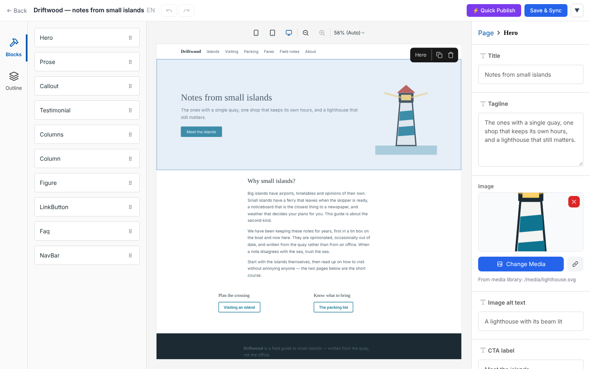
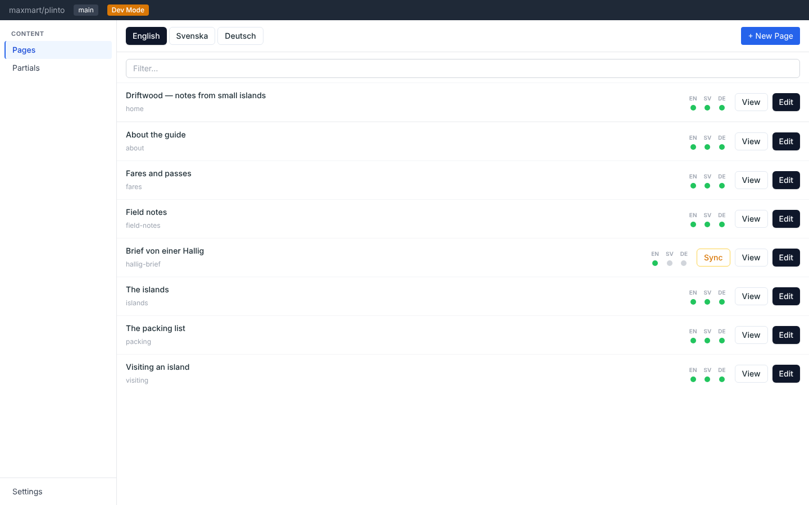

# Plinto

**Visual editing for Astro MDX sites, with AI translations that only touch what changed.**

Your React components become the editor's blocks. Editors fill in the props you expose,
and nothing else, so they can't break the design. The admin ships inside your static
site, clones the repository into the browser and publishes with a git push.
No server, no database, no lock-in.

> [!WARNING]
> Plinto is very early and experimental. It has a lot of features, but APIs and file
> conventions can change between 0.x releases. Try it on a site you could fix by hand.



## Why Plinto

- **A real git checkout in the browser.** Decap, TinaCMS and Keystatic talk to the
  GitHub API file by file, or to a backend. Plinto clones the repository with
  [isomorphic-git](https://isomorphic-git.org), so reading, diffing and merging happen
  locally, and saving is an ordinary commit. That local checkout is what makes the
  translation sync practical.
- **Translations that carry only the change.** Edit a page in any language, and a
  Claude agent applies *what changed* to the other languages instead of re-translating
  the whole page. There's no master language. Powered by
  [Obelum](https://github.com/maxmart/obelum).
- **Your components are the blocks.** The visual editor ([Puck](https://puckeditor.com))
  places your own React components, and the fields are the props you declare.
- **Your files stay yours.** Pages are plain MDX a person could have typed. An untouched
  page saves byte-identical, and a one-word edit is a one-block diff. Remove Plinto and
  the site still builds, byte for byte.



## The idea: developers own the site, editors own the content

Plinto is built for one frontend developer who builds an Astro site, and non-technical
people who edit it afterwards.

Everything about the *site* is ordinary Astro code, written by the developer: routing,
layouts, components, styling, i18n, sitemap, redirects, `robots.txt`, meta tags,
favicon. Plinto doesn't edit any of that, on purpose.

Editors work inside that frame. They place the blocks you registered and fill in the
fields you exposed. They can't add arbitrary HTML, change styles or reach anything you
didn't hand them, so the design survives every edit.

## Try it

The repository includes a complete example site in three languages:

```sh
git clone https://github.com/maxmart/plinto.git
cd plinto && npm install
cd examples/playground && npm run dev
```

Open <http://localhost:4321/plinto/admin>. In dev mode the admin edits your working
tree directly and needs no GitHub token. Translation sync asks for an Anthropic API key
the first time you run it.

## Add it to your site

```sh
npm install @plinto/astro @astrojs/react react react-dom
```

Then register the integration, point it at a CORS proxy and your block registry, and
open `/plinto/admin`. The full setup, including a few one-line config requirements, is
in [`packages/astro/README.md`](packages/astro/README.md).

What you need:

- **Astro 6 or 7**, `@astrojs/react` 5, React 19, MDX
- **Tailwind 3** configured for the admin, even if your site doesn't use it
- **A git CORS proxy** for the deployed admin. A small Cloudflare Worker to copy is in
  [`examples/proxy`](examples/proxy). It holds no credentials.
- **Per editor:** a fine-grained GitHub token with write access to the repository, and
  optionally an Anthropic API key for translations and merging

## How it works

**Editing.** In dev mode the admin reads and writes your working tree through the dev
server. On the deployed site it clones the repository into the browser (IndexedDB),
commits there, and pushes. If your CI deploys from the default branch, pushing is
publishing.

**Editors and credentials.** You invite an editor from **Settings**: create a GitHub
token for them, and Plinto bundles it with an API key into a setup code. The setup
code *is* those credentials, base64-encoded, so send it like a password. The secrets are
kept in memory for the tab, not stored in the browser. Closing the tab logs out, and a
password manager fills the login back in.

**Translations.** Each language keeps a copy of every sibling page as it last saw it,
under `.obelum/` at the repository root. When a sibling differs from that copy, the
language is behind, and the agent is shown only the difference. **Fix** marks an edit as
local (a typo, say) so it isn't propagated. Conflicting concurrent edits are merged by
an agent that asks the editor plain-language questions when it can't decide.

**Media** is stored in Git LFS. Uploads are downscaled in the browser before anything is
committed.

## Limitations

- **Pages must be made of blocks.** Root-level prose in MDX isn't supported yet. A page
  of loose prose is refused, never rewritten, so existing MDX pages keep building and
  you can convert them one at a time.
- **GitHub only** for now: the invite flow, tokens, LFS and the default proxy targets
  assume it.
- **One token per editor,** made by hand on GitHub. There's no OAuth login.
- The packages ship uncompiled TypeScript, so your Vite config must list them in
  `ssr.noExternal`.

## Packages

| Package | What it is |
|---|---|
| [`@plinto/astro`](packages/astro) | What you install: the Astro integration, admin routes and dev API |
| [`@plinto/admin`](packages/admin) | The editing app: React, Puck, MDX as storage. Not tied to Astro |
| [`@plinto/core`](packages/core) | The headless engine: content model, storage, git, agents |
| [`examples/playground`](examples/playground) | A complete three-language example site, also the test corpus |
| [`examples/proxy`](examples/proxy) | The git CORS proxy, a Cloudflare Worker |

## License

MIT
